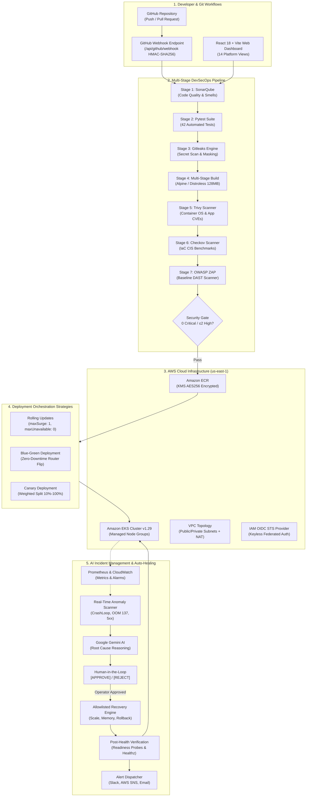

# CloudOps AI 2.0: System Architecture & Technical Specifications

**Project ID:** `DEVOPS-001` / `CLOUDOPS-2.0`  
**Classification:** Enterprise Autonomous DevOps & Reliability Engineering Platform  
**Target Roles:** Senior DevOps Engineer, Cloud Architect, Principal Site Reliability Engineer (SRE)  

---

## 1. High-Level Architecture Topology

CloudOps AI 2.0 operates as an event-driven, microservices-ready cloud control plane with bidirectional observability, autonomous AI diagnostics, and human-in-the-loop remediation guardrails.



---

## 2. Core Architectural Components

### 2.1 Backend Platform Engine (FastAPI & Python 3.11)
- **Framework:** FastAPI with asynchronous lifespan managers.
- **ORM & Data Layer:** SQLAlchemy 2.0 with connection pooling, pre-ping verification, and automated SQLite local fallback for zero-dependency development.
- **Authentication:** RFC 7519 compliant HMAC-SHA256 JWT tokens with role-based authorization hierarchies (`admin`, `devops`, `security_admin`, `viewer`).
- **Security Utilities:** DevSecOps command sanitizers preventing arbitrary command injections and regex-based secret masks that scrub logs before persistence.

### 2.2 Microservices & State Persistence Schema
The database architecture comprises 14 relational entities:
1. `users`: Credentials, PBKDF2 password hashes, and RBAC roles.
2. `projects`: Microservice manifests, repository URLs, tracking branches, environment resource limits, and webhook secrets.
3. `deployments`: Multi-strategy execution logs, active colors (`blue`/`green`), canary traffic percentages, and revision tracking.
4. `docker_images`: Image repositories, digests, multi-stage layer tags, and vulnerability counts.
5. `pipeline_executions`: End-to-end CI/CD runs with per-stage timings and live console outputs.
6. `kubernetes_clusters`: Cluster health, API endpoints, node counts, and versions.
7. `terraform_executions`: Declarative HCL lifecycle actions (`init`, `validate`, `plan`, `apply`, `destroy`).
8. `ai_analysis_records`: Gemini AI diagnostic outputs, root causes, and confidence metrics.
9. `rollback_records`: SRE automated and manual rollback audit records.
10. `incidents`: Real-time incident logs, error categories (`CrashLoopBackOff`, `OOMKilled`, `ImagePullBackOff`, `HighCPU`, `Downtime5xx`), severities, and MTTR seconds.
11. `ai_recommendations`: Structured Gemini diagnostic remedies, risk assessments, and safe parameters.
12. `recovery_actions`: Human-in-the-loop approval cards, expirations, execution logs, and post-health checks.
13. `security_scans`: Stage-by-stage security reports from SonarQube, Pytest, Gitleaks, Trivy, Checkov, and OWASP ZAP.
14. `audit_logs`: Immutable audit trail recording user actions, IP addresses, resource targets, and timestamps.

---

## 3. Deployment Strategy Mechanics

### 3.1 Rolling Update Strategy
- **Configuration:** `maxSurge: 1`, `maxUnavailable: 0`.
- **Workflow:** Incremental replacement of existing pods with new version replicas. Traffic is routed exclusively to pods that pass initial HTTP readiness probes (`/healthz` and `/ready`).

### 3.2 Blue-Green Deployment Strategy
- **Configuration:** Two parallel deployments (`app-blue` and `app-green`) fronted by a single Kubernetes `Service`.
- **Workflow:** The new version is deployed to the idle environment (e.g. `green`). Once pre-flight readiness checks succeed, the platform updates the Service's selector from `color: blue` to `color: green` in a single atomic transaction. In case of issues, an instant 1-click fallback restores traffic to `blue`.

### 3.3 Canary Deployment Strategy
- **Configuration:** Baseline primary deployment alongside a secondary canary deployment with weighted pod ratios (10%, 25%, 50%, 100%).
- **Workflow:** Routes a fraction of user requests to the canary container. SRE telemetry evaluates error rates and P99 latency percentiles before promoting the canary to 100% of the fleet.

---

## 4. AI-Powered Auto-Healing Guardrails

CloudOps AI 2.0 enforces strict DevSecOps safety policies regarding autonomous actions:

```
[Incident Detection: CrashLoopBackOff]
                ↓
   [Google Gemini Diagnostic]
                ↓
  [Action Parameter Allowlist Check]
                ↓
      [Human-in-the-Loop Gate]
        ├── Rejected ──> [Audit Logged & Abandoned]
        └── Approved ──> [Safe Execution via Allowed API]
                                ↓
                 [Readiness Probe Post-Verification]
                                ↓
                     [Slack / SNS Notification]
```

### Allowlisted Action Matrix:
| Action | Permitted Parameters | Guardrail Constraint |
|---|---|---|
| `restart_pod` | `pod_name`, `namespace` | Only targets pods with >3 restarts or CrashLoop |
| `increase_resource_limits` | `deployment`, `memory_limit` (max 2Gi) | Prevents worker node memory starvation |
| `scale_deployment` | `deployment`, `replicas` (range 1-10) | Prevents cloud resource stockouts |
| `rollback_deployment` | `deployment`, `target_revision` | Reverts to last known healthy revision |
| `switch_blue_green` | `deployment`, `target_color` (`blue`/`green`) | Atomic service selector change only |

---

## 5. DevSecOps Security Pipeline Specifications

| Stage | Tool | Evaluation Criteria | Enforcement |
|---|---|---|---|
| **Stage 1** | SonarQube | Quality Gate Grade A, 0 Bugs, Code Coverage ≥80% | Blocks deployment on Grade C-F |
| **Stage 2** | Pytest | 100% test pass rate across unit and integration tests | Blocks on any test assertion failure |
| **Stage 3** | Gitleaks | Regex search for AWS, GitHub, GCP, and database credentials | Immediate gate failure; secret masking in logs |
| **Stage 4** | Trivy | Container image package and dependency CVE scan | Blocks if Critical > 0 or High > 2 |
| **Stage 5** | Checkov | 27 CIS AWS Foundation & Kubernetes benchmark checks | Flags unencrypted buckets and root users |
| **Stage 6** | OWASP ZAP | Dynamic application baseline DAST (CSP, HSTS, XSS) | Generates compliance reports and remediation guidance |
| **Stage 7** | Gatekeeper | Evaluates all previous 6 stage results | Security Admin manual override with mandatory audit |

