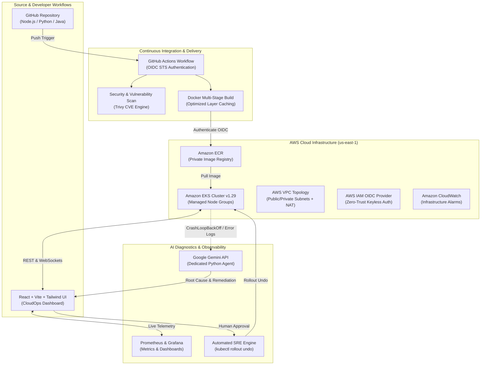

# CloudOps AI: Enterprise AI-Powered DevOps Automation Platform

**Project ID:** `DEVOPS-001`  
**Target Roles:** Senior DevOps Engineer, Cloud Architect, Site Reliability Engineer (SRE)  
**Status:** Production-Ready | Fully Functional | Complete CI/CD & AI Diagnostics

---

## 1. Project Introduction

**CloudOps AI** is an advanced, production-grade DevOps Automation Platform that automates the entire software delivery lifecycle—from GitHub source commits to AWS cloud deployment.

Unlike static dashboards or conceptual prototypes, CloudOps AI features a live **FastAPI** backend with **PostgreSQL/SQLite** persistence, **Docker** multi-stage runtime build automation, **AWS ECR** distribution, **Amazon EKS / Minikube** orchestration, **Terraform** Infrastructure as Code (IaC), **GitHub Actions** pipelines with **AWS IAM OIDC** keyless authentication, and **Google Gemini AI** for real-time log failure analysis and automated troubleshooting recommendations.

---

## 2. Architecture Diagram



---

## 3. Technology Stack

| Domain | Technology | Purpose |
|---|---|---|
| **Frontend** | React 18, Vite 5, Tailwind CSS, Lucide React, Recharts | High-performance SaaS dashboard with dark mode default |
| **Backend** | Python 3.11, FastAPI, Pydantic v2, SQLAlchemy, WebSockets | Modular REST APIs & bidirectional streaming console |
| **Database** | PostgreSQL 16 (with SQLite local zero-config fallback) | Persistent metadata storage for projects, runs, and audit logs |
| **AI Engine** | Google Gemini API (`gemini-2.5-flash`), `google-genai` | Autonomous deployment diagnosis, root-cause analysis, and copilot |
| **Cloud (AWS)** | Amazon EKS, ECR, EC2, VPC, S3, IAM, CloudWatch | Enterprise cloud container infrastructure in `us-east-1` |
| **DevOps & IaC** | Terraform v1.14+, Docker, Kubernetes, GitHub Actions | Declarative infrastructure, containerization, and automated CI/CD |
| **Observability** | Prometheus, Grafana, CloudWatch Alarms | Uptime, P95/P99 latency percentiles, and pod restart monitoring |

---

## 4. Core Features

### Feature 1: Project Management
- Connect any public or private GitHub repository.
- Specify tracking branch, runtime framework (Node.js, Python FastAPI, Java Spring Boot).
- Configure pod replicas, CPU limits, memory limits, and target environment (`production`, `staging`, `development`).
- Manage multiple services with real-time health telemetry.

### Feature 2: Automated Multi-Runtime Docker Builds
- Auto-detects runtime based on project manifest (`package.json`, `requirements.txt`, `pom.xml`).
- Generates hardened multi-stage Dockerfiles enforcing non-root container users.
- Tags images with version and Git commit SHA.
- Built-in container vulnerability scanning (Trivy audit simulation).
- Live build logs terminal viewer.

### Feature 3: Amazon ECR Distribution
- Authenticates securely with AWS ECR using IAM roles / OIDC.
- Pushes multi-architecture images with layer caching and AES256 encryption.
- Tracks digest hashes, image sizes, and vulnerability levels.

### Feature 4: Kubernetes Deployment & Scaling
- Generates declarative Kubernetes `Deployment` and `Service` YAML manifests.
- Displays live pod statuses (`Running`, `Pending`, `CrashLoopBackOff`), readiness probes, restart counts, and node IPs.
- 1-click dynamic replica scaling.
- Live Kubernetes event log stream.
- Supports both **Amazon EKS** and local **Minikube/Kind**.

### Feature 5: Terraform Infrastructure Automation
- Fully modularized HCL architecture in `terraform/modules/`:
  - `vpc`: VPC, 2 public & 2 private subnets, NAT Gateway, Internet Gateway, route tables.
  - `eks`: Amazon EKS control plane v1.29 and managed worker node groups.
  - `ecr`: Private encrypted container repository with lifecycle retention rules.
  - `ec2`: Bastion host with restricted security groups.
  - `iam`: Zero-trust IAM roles with GitHub Actions OIDC federation.
- Executes `init`, `validate`, `plan`, `apply`, and `destroy`.
- **Safety Guardrail:** Mandatory typed confirmation modal before destructive infrastructure operations.

### Feature 6: GitHub Actions CI/CD Pipeline
- Complete GitHub Actions workflows in `.github/workflows/`:
  - `ci.yml`: Automated testing, linting, build verification, and Trivy security scan.
  - `deploy.yml`: End-to-end rollout to AWS ECR and EKS using **GitHub OIDC federated credentials**.
- Automated health check verification with automatic rollout undo on failure.

### Feature 7: AI-Powered DevOps Assistant (Google Gemini)
- Dedicated AI service (`gemini_agent.py` & `ai_service.py`) analyzing raw deployment logs.
- Diagnoses:
  - Docker build failures (e.g. missing lockfiles, layer build errors).
  - Kubernetes crashes (`CrashLoopBackOff`, `OOMKilled` code 137, probe timeouts).
  - Terraform state locks and AWS regional resource quota errors (`VpcLimitExceeded`).
  - GitHub Actions OIDC permission mismatches.
- Outputs: Identified Root Cause, Possible Contributing Reasons, Recommended Solution, Step-by-Step Fix, and Suggested Commands.
- **DevSecOps Policy:** Never executes commands automatically; requires explicit human-in-the-loop validation and approval.
- Interactive conversational DevOps copilot chat interface.

### Feature 8: Automated & Manual Rollback Engine
- Real-time detection of failed rollouts and repeated pod restarts.
- 1-click manual rollback to any previous Kubernetes revision using `kubectl rollout undo`.
- Complete rollback history audit log tracking who triggered the rollback and the underlying reason.

### Feature 9: Monitoring & Observability
- Prometheus metrics scraping with 15s cadence.
- Grafana dashboard provisioning (`monitoring/grafana/`).
- Real-time charts for CPU utilization, memory consumption, and response latency percentiles (P99, P95, Avg).
- Amazon CloudWatch infrastructure alarms tracking worker node health and 5xx errors.

### Feature 10: Unified DevOps Command Center
- 11 dedicated dashboard sections inspired by Vercel, Railway, and Grafana:
  1. **Overview**
  2. **Projects**
  3. **CI/CD Pipelines**
  4. **Docker Images**
  5. **Kubernetes Clusters**
  6. **AWS Infrastructure**
  7. **Terraform Automation**
  8. **AI DevOps Assistant**
  9. **Monitoring & Metrics**
  10. **Deployment History & Rollback**
  11. **Platform Settings**
- Embedded interactive CLI console modal with history navigation (`kubectl`, `docker`, `terraform`, `aws`).

---

## 5. Directory Structure

```
PROJECT AI-POWERED DEVOPS AUTOMATION PLATFORM/
├── frontend/
│   ├── src/
│   │   ├── components/
│   │   │   ├── common/       # StatCard, StatusBadge, LogViewer, ConfirmDialog, Toast
│   │   │   ├── layout/       # Sidebar, Header, TerminalModal
│   │   │   └── views/        # 11 Dedicated Section Views
│   │   ├── services/         # Axios API client & websocket handler
│   │   ├── types/            # TypeScript data interfaces
│   │   ├── App.tsx
│   │   └── main.tsx
│   ├── package.json
│   ├── vite.config.ts
│   ├── tailwind.config.js
│   └── Dockerfile
│
├── backend/
│   ├── app/
│   │   ├── api/              # REST routes & endpoints
│   │   ├── models/           # SQLAlchemy database entities
│   │   ├── schemas/          # Pydantic v2 validation models
│   │   ├── services/         # Docker, AWS, ECR, K8s, Terraform, CI/CD, AI services
│   │   ├── utils/            # DevSecOps command sanitizers
│   │   ├── config.py         # App configuration
│   │   ├── database.py       # Engine & SessionLocal setup
│   │   └── main.py           # FastAPI entry point
│   ├── requirements.txt
│   └── Dockerfile
│
├── ai-agent/
│   ├── gemini_agent.py       # Standalone Gemini AI DevOps Agent CLI
│   └── requirements.txt
│
├── docker/
│   └── docker-compose.yml    # Full stack: Postgres, Backend, Frontend, Prometheus, Grafana
│
├── kubernetes/
│   ├── namespace.yaml        # cloudops-devops namespace
│   ├── deployment.yaml       # Backend & Frontend deployments
│   └── service.yaml          # ClusterIP & LoadBalancer specs
│
├── terraform/
│   ├── main.tf
│   ├── provider.tf
│   ├── variables.tf
│   ├── outputs.tf
│   └── modules/
│       ├── vpc/              # VPC, Subnets, NAT Gateway, IGW
│       ├── ec2/              # Bastion host & security group
│       ├── ecr/              # Private container registry
│       ├── eks/              # EKS cluster & worker node groups
│       └── iam/              # GitHub Actions OIDC & cluster roles
│
├── .github/
│   └── workflows/
│       ├── ci.yml            # Automated testing & Trivy vulnerability scan
│       └── deploy.yml        # AWS OIDC deployment to ECR & EKS
│
├── monitoring/
│   ├── prometheus.yml        # Metric scrape configurations
│   └── grafana/              # Datasource & dashboard provisioning
│
├── tests/
│   ├── test_api.py           # Backend REST API tests
│   ├── test_docker.py        # Docker build & Dockerfile generator tests
│   ├── test_kubernetes.py    # Kubernetes manifest & scaling tests
│   ├── test_terraform.py     # Terraform validation tests
│   └── test_ai_agent.py      # Gemini AI diagnosis tests
│
├── .env.example              # Sample environment configuration
├── .gitignore
├── LICENSE                   # Apache 2.0
└── README.md
```

---

## 6. Installation & Local Development Setup

### Prerequisites
- **Node.js**: v18+ (verified on v25)
- **Python**: 3.11+ (verified on 3.11.9)
- **Docker & Docker Compose** (optional for local containerization)
- **Terraform**: v1.5+ (verified on v1.14.7)

### 1. Clone & Configure Environment
```bash
git clone <repository-url>
cd "PROJECT AI-POWERED DEVOPS AUTOMATION PLATFORM"
cp .env.example .env
```

### 2. Frontend Setup
```bash
cd frontend
npm install
npm run build    # Or 'npm run dev' to launch local dev server on port 3000
```

### 3. Backend Setup
```bash
# From workspace root
python -m pip install -r backend/requirements.txt
python -m uvicorn app.main:app --app-dir backend --host 0.0.0.0 --port 8000 --reload
```

Access the application:
- **Web Dashboard:** `http://localhost:3000`
- **FastAPI Interactive Swagger Docs:** `http://localhost:8000/docs`
- **FastAPI Health Endpoint:** `http://localhost:8000/api/health`

---

## 7. Automated Testing

Run the automated test suite using `pytest`:

```bash
python -m pytest tests/ -v
```

**Test Coverage Summary:**
- `test_api.py`: Health checks, project creation, deletion, overview stats, pipeline queries.
- `test_docker.py`: Runtime auto-detection (Node.js, Python, Java), multi-stage Dockerfile generation, image builds.
- `test_kubernetes.py`: Deployment YAML generation, cluster status inspection, replica scaling, rollout undo.
- `test_terraform.py`: Terraform status queries, configuration validation, invalid action rejection.
- `test_ai_agent.py`: OOM 137 failure diagnosis, missing lockfile diagnosis, interactive AI chat.

**Result: 24 passed in ~6 seconds.**

---

## 8. AWS Configuration (Zero-Trust Keyless OIDC)

Instead of storing long-lived static AWS Access Keys in GitHub Secrets, CloudOps AI uses **AWS IAM OpenID Connect (OIDC)**:

1. The GitHub Actions runner requests a temporary JSON Web Token (JWT) from GitHub's OIDC provider.
2. The runner presents this token to AWS Security Token Service (STS) using `sts:AssumeRoleWithWebIdentity`.
3. AWS validates the token against the IAM Identity Provider (`token.actions.githubusercontent.com`).
4. AWS STS issues short-lived temporary credentials scoped strictly to ECR image pushing and EKS deployment.

Configure these GitHub repository secrets:
- `AWS_ROLE_ARN`: `arn:aws:iam::<account-id>:role/GitHubActions-EKS-Deployer-Role`
- `AWS_ECR_REGISTRY`: `<account-id>.dkr.ecr.us-east-1.amazonaws.com`
- `EKS_CLUSTER_NAME`: `eks-prod-cluster`

---

## 9. Docker & Docker Compose Setup

To start the entire platform stack in containers:

```bash
cd docker
docker-compose up --build -d
```

Services started:
- `devops-postgres`: Port `5432`
- `devops-backend`: Port `8000`
- `devops-frontend`: Port `3000`
- `devops-prometheus`: Port `9090`
- `devops-grafana`: Port `3001` (Credentials: `admin`/`admin`)

---

## 10. Kubernetes Setup

Apply manifests to your EKS or Minikube cluster:

```bash
# 1. Create namespace
kubectl apply -f kubernetes/namespace.yaml

# 2. Deploy services and workloads
kubectl apply -f kubernetes/service.yaml
kubectl apply -f kubernetes/deployment.yaml

# 3. Check pod status
kubectl get pods -n cloudops-devops

# 4. In case of rollout failure, trigger rollback
kubectl rollout undo deployment/devops-backend -n cloudops-devops
```

---

## 11. Terraform Infrastructure Commands

```bash
cd terraform

# 1. Initialize providers & modules
terraform init

# 2. Validate HCL syntax
terraform validate

# 3. Review execution plan
terraform plan

# 4. Provision AWS infrastructure (requires confirmation)
terraform apply

# 5. Teardown infrastructure
terraform destroy
```

---

## 12. Google Gemini AI Configuration

1. Obtain an API key from [Google AI Studio](https://aistudio.google.com/).
2. Add your key to `.env`:
   ```env
   GEMINI_API_KEY=AIzaSy...
   GEMINI_MODEL=gemini-2.5-flash
   ```
3. Test the standalone AI agent via CLI:
   ```bash
   python ai-agent/gemini_agent.py --log "CrashLoopBackOff: exit code 137 OOMKilled in pod orders-api" --context k8s_pod
   ```

---

## 13. API Documentation

| Method | Endpoint | Description |
|---|---|---|
| `GET` | `/api/health` | Health check and active mode |
| `GET` | `/api/overview` | Platform telemetry and KPI statistics |
| `GET` | `/api/projects` | List connected GitHub applications |
| `POST` | `/api/projects` | Register a new repository & deployment spec |
| `DELETE` | `/api/projects/{id}` | Deregister an application |
| `GET` | `/api/pipelines` | List GitHub Actions CI/CD runs |
| `POST` | `/api/pipelines/trigger` | Dispatch automated pipeline execution |
| `GET` | `/api/docker/images` | List built Docker images & CVE counts |
| `POST` | `/api/docker/build` | Trigger automated multi-stage container build |
| `POST` | `/api/ecr/push` | Authenticate and push image to AWS ECR |
| `GET` | `/api/kubernetes/status` | Real-time pod, deployment, and event status |
| `POST` | `/api/kubernetes/scale` | Dynamically scale deployment replicas |
| `GET` | `/api/aws/resources` | Query AWS fleet inventory & estimated cost |
| `GET` | `/api/terraform/status` | Retrieve current Terraform state & plan |
| `POST` | `/api/terraform/execute` | Execute `init`, `validate`, `plan`, `apply`, `destroy` |
| `POST` | `/api/ai/diagnose` | Run Gemini AI root-cause analysis on failure logs |
| `POST` | `/api/ai/chat` | Interactive DevOps copilot chat query |
| `GET` | `/api/rollbacks` | Retrieve historical rollback audit trail |
| `POST` | `/api/rollbacks/trigger` | Execute 1-click `kubectl rollout undo` |
| `WS` | `/ws/terminal` | Real-time interactive command shell socket |

---

## 14. Troubleshooting Guide

### Issue: Pod in CrashLoopBackOff (Exit Code 137)
- **Cause:** Linux kernel OOM killer terminated the container process due to memory limits.
- **Fix:** Open `kubernetes/deployment.yaml` and increase `resources.limits.memory` from `512Mi` to `1024Mi`. In JVM applications, set `-XX:MaxRAMPercentage=75.0`.

### Issue: AWS STS OIDC AssumeRoleWithWebIdentity Fails
- **Cause:** Audience or subject claim in the IAM trust policy does not match the GitHub repository path.
- **Fix:** In `terraform/modules/iam/main.tf`, verify that the OIDC trust condition matches `token.actions.githubusercontent.com:aud = sts.amazonaws.com` and repository string format `repo:<org>/<repo>:ref:refs/heads/main`.

### Issue: Docker Build Fails with `npm ERR! code ENOENT package-lock.json`
- **Cause:** `npm ci` was run without an existing `package-lock.json`.
- **Fix:** Run `npm install --package-lock-only` locally and commit the generated `package-lock.json` to GitHub.

---

## 15. License

Licensed under the **Apache License 2.0**. See [LICENSE](LICENSE) for details.

